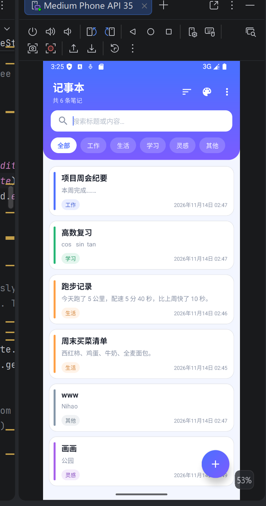
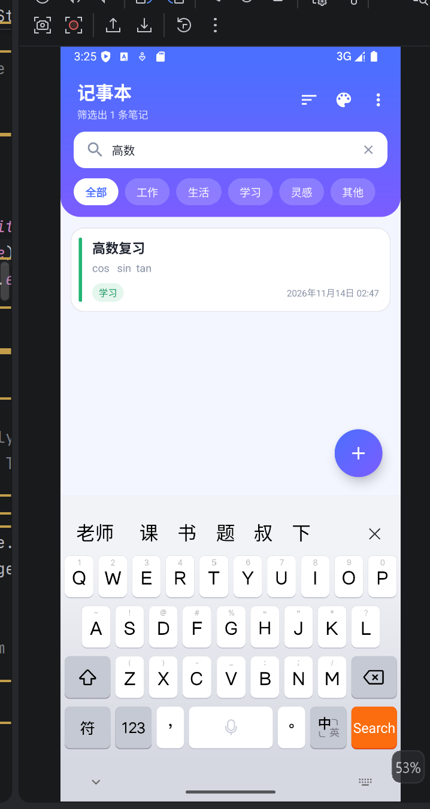
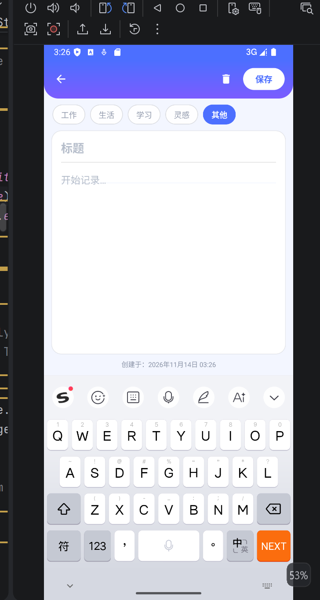
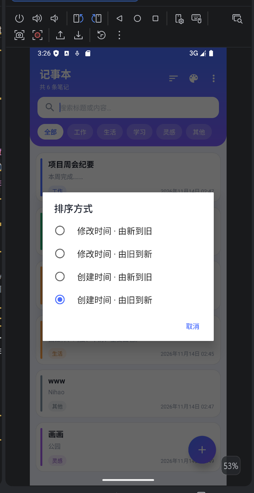
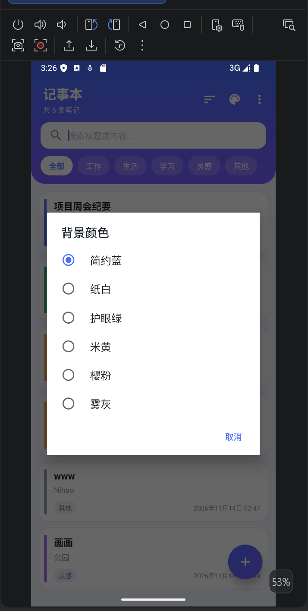

# 记事本 NotePad

基于 Android 官方 **NotePad** 示例扩展而来的本地记事本应用。在保留 `ContentProvider + SQLite` 原始架构的前提下，补齐了时间戳、搜索、分类、排序、换肤等能力，并重做了整套界面。


---

## 目录

- [功能特性](#功能特性)
- [界面预览](#界面预览)
- [界面与操作](#界面与操作)
- [技术实现](#技术实现)
- [项目结构](#项目结构)

---

## 功能特性

### 基本要求

| 功能 | 实现说明 |
| --- | --- |
| **列表时间戳** | 每张卡片右下角显示 `yyyy年MM月dd日 HH:mm`（年月日 + 时分），由 `NoteAdapter` 对 `modified` 字段格式化。 |
| **笔记查询** | 顶部搜索框按 **标题或内容** 模糊匹配，SQL 条件为 `(title LIKE ? OR note LIKE ?)`；输入停顿 180ms 才发起查询，避免逐字刷新；右侧有 × 一键清空；无结果时展示空状态提示。 |

### 附加功能

| 功能 | 实现说明 |
| --- | --- |
| **笔记分类** | `notes` 表新增 `category` 列，内置 **工作 / 生活 / 学习 / 灵感 / 其他** 五类。列表顶部胶囊栏可筛选（含「全部」），编辑页顶部可切换，长按卡片也能直接改分类。卡片左侧显示分类色条，底部显示彩色标签。 |
| **笔记排序** | 右上角排序按钮，四种方式：修改时间 / 创建时间 × 由新到旧 / 由旧到新。选择结果写入 `SharedPreferences`，重启后保持。 |
| **更换背景颜色** | 内置 **简约蓝 / 纸白 / 护眼绿 / 米黄 / 樱粉 / 雾灰** 六套浅色主题，列表页与编辑页同步生效；系统导航栏跟随主题，状态栏保持品牌蓝以保证顶栏连贯，选择持久化。 |
| **UI 美化** | 渐变圆角顶栏、卡片式列表（圆角 + 阴影 + 点击水波）、胶囊分类栏、悬浮新建按钮、空列表引导页、自绘编辑工具栏（返回 / 删除 / 保存）。 |

### 交互细节

- **粘贴**：编辑页菜单可把剪贴板内容插入正文。
- **长按菜单**：打开 / 更改分类 / 复制 / 删除（删除带二次确认）。
- **标题自动生成**：标题留空时，自动取正文首行作为标题。
- **只读不脏写**：打开笔记不做修改就返回，**不会**刷新修改时间、不会把笔记顶到列表最前（原示例存在这个问题）。
- **空白笔记自动清理**：新建后什么都没写就退出，这条笔记会被自动删除。

---

## 界面预览

| 笔记列表 | 搜索（标题 / 内容） | 编辑页 |
| :---: | :---: | :---: |
|  |  |  |
| 分类色条、彩色标签、右下角时间戳 | 输入即筛，标题与正文同时匹配 | 顶部分类切换，底部显示创建时间 |

| 排序方式 | 背景颜色 |
| :---: | :---: |
|  |  |
| 修改时间 / 创建时间 × 由新到旧 / 由旧到新 | 六套配色，列表页与编辑页同步生效 |

---

## 界面与操作

| 想做什么 | 操作位置 |
| --- | --- |
| 新建笔记 | 列表页右下角悬浮按钮 `+` |
| 搜索 | 列表页顶部搜索框，输入即筛（标题 + 内容） |
| 按分类筛选 | 列表页顶部胶囊栏，点击「全部 / 工作 / 生活 …」 |
| 切换排序方式 | 列表页右上角排序图标 → 四选一 |
| 切换背景颜色 | 列表页右上角调色板图标 → 六选一 |
| 改分类 / 删除 / 复制 | **长按**列表卡片 → 弹出菜单 |
| 编辑标题 | 编辑页顶部标题输入框 |
| 切换分类 | 编辑页顶部分类胶囊栏 |
| 保存 | 编辑页右上角保存按钮（返回时也会自动保存） |

---

## 技术实现

### 整体架构

沿用官方示例的分层，UI 不做直接数据库操作，全部经 `ContentResolver` 走 `NotePadProvider`：

```
NotesList / NoteEditor / TitleEditor     ← Activity（UI 层）
            │  ContentResolver
            ▼
     NotePadProvider                     ← ContentProvider（数据访问层）
            │  SQLiteDatabase
            ▼
      notes 表（notepad.db）              ← 持久化
```

`NotePad.java` 是契约类，集中定义 AUTHORITY、表名、列名、Uri 与排序常量，UI 层与 Provider 层共用，避免字符串散落。

### 数据库表结构

表名 `notes`，数据库版本 **3**：

| 列名 | 类型 | 说明 |
| --- | --- | --- |
| `_id` | INTEGER | 主键，自增 |
| `title` | TEXT | 标题，可为空字符串 |
| `note` | TEXT | 正文 |
| `created` | INTEGER | 创建时间戳（毫秒） |
| `modified` | INTEGER | 修改时间戳（毫秒） |
| `category` | TEXT | 分类，默认 `其他`（v3 新增） |

**版本升级**：v2 → v3 用 `ALTER TABLE ... ADD COLUMN` 增量加列，**不清空已有笔记**；只有在 `ALTER TABLE` 异常时才降级为重建表：

```java
try {
    db.execSQL("ALTER TABLE notes ADD COLUMN category TEXT DEFAULT '其他'");
} catch (SQLException e) {
    Log.w(TAG, "ALTER TABLE failed, recreating table", e);
    db.execSQL("DROP TABLE IF EXISTS notes");
    onCreate(db);
}
```

### 核心模块

| 文件 | 行数 | 职责 |
| --- | ---: | --- |
| `NotePad.java` | 173 | 契约类：表名 / 列名 / Uri / 四种排序常量 / 默认分类 |
| `NotePadProvider.java` | 775 | 数据库创建与升级、Uri 匹配、增删改查、默认值填充 |
| `NotesList.java` | 484 | 列表页：搜索去抖、分类筛选、排序、换肤、长按菜单、空状态 |
| `NoteEditor.java` | 713 | 编辑页：标题输入、分类选择、时间显示、脏数据判断、自动保存 |
| `NoteAdapter.java` | 116 | 卡片渲染：标题 / 摘要 / 分类色条与标签 / 时间戳 |
| `ChipBar.java` | 137 | 自定义胶囊选择栏，列表页（深色底）与编辑页（浅色底）复用 |
| `AppPrefs.java` | 73 | 主题与排序的偏好存取 |
| `CategoryUtil.java` | 72 | 分类名称、顺序、配色的统一管理 |
| `TitleEditor.java` | 167 | 官方示例保留的「单独编辑标题」入口 |
| `NotesLiveFolder.java` | 113 | 官方示例保留的 Live Folder 支持 |


## 项目结构

```
NotePad/
├── app/
│   ├── build.gradle
│   └── src/
│       ├── main/
│       │   ├── AndroidManifest.xml
│       │   ├── java/com/example/android/notepad/
│       │   │   ├── NotePad.java            契约类
│       │   │   ├── NotePadProvider.java    ContentProvider + SQLite
│       │   │   ├── NotesList.java          列表页
│       │   │   ├── NoteEditor.java         编辑页
│       │   │   ├── TitleEditor.java        标题编辑
│       │   │   ├── NotesLiveFolder.java    Live Folder
│       │   │   ├── NoteAdapter.java        列表适配器
│       │   │   ├── ChipBar.java            自定义胶囊栏
│       │   │   ├── AppPrefs.java           偏好存储
│       │   │   └── CategoryUtil.java       分类与配色
│       │   └── res/
│       │       ├── layout/                 notes_list / noteslist_item / note_editor / title_editor
│       │       ├── drawable/               背景与图标（全部矢量 VectorDrawable）
│       │       ├── menu/                   长按菜单、编辑页菜单
│       │       └── values/                 colors / styles / strings / arrays
│       └── androidTest/                    Provider 与 Activity 的仪器测试
├── build.gradle
├── settings.gradle
└── gradle/wrapper/
```

---

